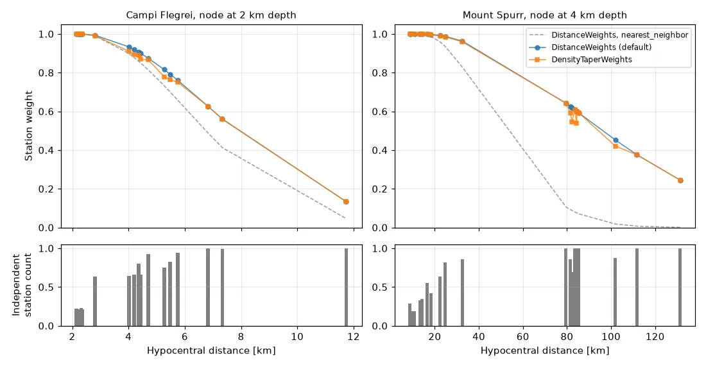
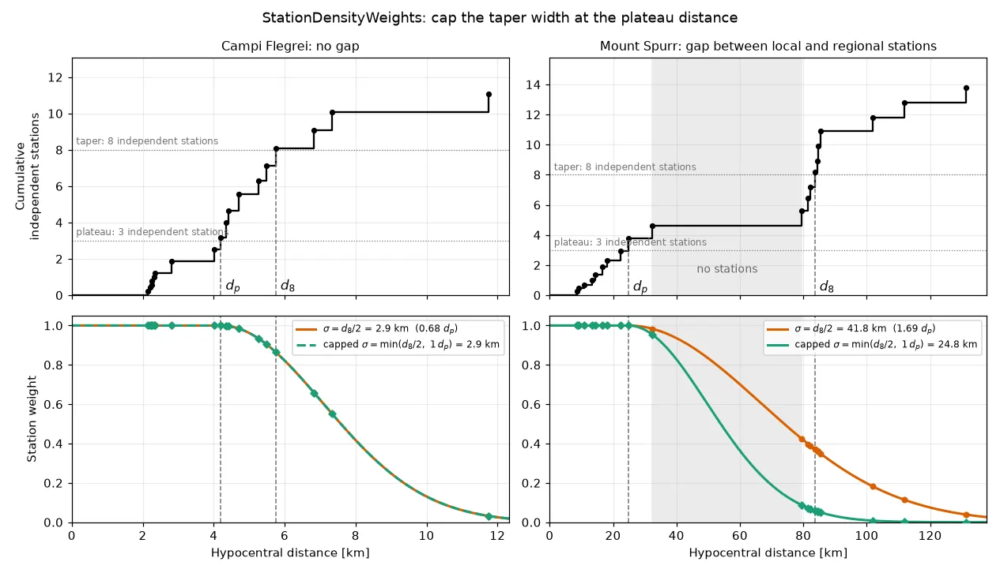

[](){ #qseek.station_weights.StationWeightsType }

# Station weights

Station weights decide how much each station contributes to the stack of a node. Qseek calculates a weight for every pair of station and node in the search volume from their distance, see [stacking and migration](../concepts/how-it-works.md#stacking-and-migration). For every node and phase, the weights are normalized to a sum of one. Close stations get full weight: they record small events with the highest phase confidence and constrain the location best. Distant stations are tapered.

| Station weights | Full weight | Taper |
| --- | --- | --- |
| [`DistanceWeights`](#distance-weights) (default) | The 4 closest stations | Gaussian, full width at half maximum twice the mean interstation distance |
| [`DensityTaperWeights`](#density-taper-weights) | The 4 closest stations | As `DistanceWeights`; far away, each weight approaches the taper times the independent station count |
| [`DensityPlateauWeights`](#density-plateau-weights) | The closest 4 independent stations, up to the plateau distance $d_p$ | As `DistanceWeights`, beyond $d_p$ |
| [`StationDensityWeights`](#station-density-weights) | The closest 3 independent stations, up to the plateau distance $d_p$ | Gaussian, standard deviation σ from the distance of the closest 16 independent stations |

`station_weights` takes one of them. With `null`, all stations get the same weight.


/// caption
Station weights of a node, with the defaults, for two examples of the [playground](../getting-started/playground.md). Left: Campi Flegrei, 18 stations within 12 km, node at 2 km depth below Solfatara. Right: Mount Spurr, Alaska, node at 4 km depth below sea level beneath the volcano; ten local stations within 32 km and ten regional stations from 79 km to 131 km. Dashed: `DistanceWeights` with the taper `"nearest_neighbor"`. Bottom: the independent station count of each station; the dotted line marks the plateau distance of `StationDensityWeights`, where the closest stations add up to 3 independent stations.
///

## Choose the station weights

- **`DistanceWeights`**, the default, give the 4 closest stations full weight and taper over twice the mean interstation distance. They locate best on the examples of the playground and suit most local and regional networks.
- **`DensityTaperWeights`** keep the weights of `DistanceWeights` for the closest stations and count a distant cluster of stations as its [independent stations](#independent-stations). Try them for a network with a dense cluster next to sparse stations. On Campi Flegrei, where the cluster lies above the seismicity, they locate as consistently as `DistanceWeights`. At Norcia, 49 stations with a cluster of 12 at about 28 km from the seismicity, they find 70 more well-constrained detections at the same location consistency.
- **`DensityPlateauWeights`** extend the plateau of full weight until the closest stations add up to 4 independent stations. Near a cluster more stations get full weight. On Campi Flegrei they locate less consistently than `DistanceWeights`.
- **`StationDensityWeights`** count the stations of a dense cluster as fewer independent stations and adapt the plateau and the taper to the station spacing around each node. On Norcia they find 6% more well-constrained detections than `DistanceWeights` at the same location accuracy. On Campi Flegrei they locate less consistently.

The weights change from node to node, and they are normalized per node. A taper that falls off steeply between neighboring nodes therefore moves the locations as well: the stack prefers the nodes where the stations that recorded the event carry most of the weight. Keep the taper smooth. Over the distances where stations still record the events, the weights should decay as the phase confidence decays with distance. On the playground, a narrower taper and more or fewer stations with full weight both locate the detections less consistently than the defaults of `DistanceWeights`. The [benchmark](../about/benchmark.md#station-weights) has the results.

## Independent stations

Stations a few hundred meters apart record nearly the same waveforms and share the errors of the velocity model along their paths. `StationDensityWeights` count how many *independent stations* each station is worth. An isolated station counts as one independent station, a station in a dense cluster as a fraction of one:

$$
c = 1 - \frac{k - k_\mathrm{min}}{k_\mathrm{max}}
$$

with the density $k$ of the neighboring stations, a Gaussian kernel as wide as the median distance between neighboring sites, and the lowest and highest density of the network, $k_\mathrm{min}$ and $k_\mathrm{max}$. The densest station keeps $k_\mathrm{min} / k_\mathrm{max}$, so every station counts. Sensors closer than 50 m, e.g. a broadband and a strong-motion sensor of one site, share a site and together count as the site. The counts are relative: they change when stations have no data in a window.

On Campi Flegrei, the 18 INGV stations count as 11.1 independent stations: the six stations in the center of the caldera, 200 m to 500 m apart, count as 0.2 each. At Mount Spurr, the 20 stations count as 13.8 independent stations, the ten local stations as 4.6. Qseek logs the count when the search starts.

## Station density weights

The closest stations of a node get full weight until they add up to `plateau_stations` independent stations, 3 by default, at the plateau distance $d_p$. In a dense cluster more stations get full weight than in a sparse network. Beyond $d_p$, a Gaussian taper decays; its standard deviation is half the distance at which the closest stations add up to `taper_stations`, 16 by default. When the network has fewer independent stations than `taper_stations`, the most distant station sets the width.

`taper_cap` limits the standard deviation of the taper, in units of $d_p$. It is off by default. A gap in the network can put the `taper_stations` far away, e.g. between local and regional stations, and the cap shortens the taper to the local stations. A short taper, however, changes the weights steeply between neighboring nodes and moves the locations. With `taper_stations` 8 and `taper_cap` 1.0, the 10-day example of Campi Flegrei shows walls of detections up to 3 km deep, and at Norcia detections move above sea level. Use the cap only if distant stations add more noise than signal, and check the locations.


/// caption
The cap of the taper on two nodes of the playground examples, with `taper_stations` 8. Top: the closest stations add up to independent stations; $d_p$ marks 3 independent stations, the plateau, $d_8$ marks 8, which sets the taper width $\sigma = d_8 / 2$. Bottom: the station weights without the cap (orange) and with `taper_cap` 1.0 (green). Left: on Campi Flegrei, without a gap, the cap does not bind. Right: at Mount Spurr, $d_8$ lies beyond the gap between the local and the regional stations; the cap shortens the taper width by 40%, from 41.8 km to 24.8 km, and lowers the weights of the regional stations to 0.09 and less.
///

```python exec='on'
from qseek.utils import json_example
from qseek.station_weights import StationDensityWeights

print(json_example(StationDensityWeights()))
```

<div class="qs-config" markdown>

::: qseek.station_weights.StationDensityWeights
    options:
      heading_level: 3

</div>

## Density taper weights

`DensityTaperWeights` start from the weight $g$ of `DistanceWeights` and the independent station count $c$ of each station:

$$
w = g \left( c^\beta + (1 - c^\beta)\, g \right)
$$

The closest stations keep their full weight ($g = 1$), also within a cluster. Seen from a distance, the stations of a cluster record an event from nearly the same direction; with $g$ falling off, their weight approaches $g\, c^\beta$, so the cluster weighs as much as its independent stations. `station_density` is the exponent $\beta$, 1 by default; with 0 these are the `DistanceWeights`. The weights change between nodes as smoothly as the `DistanceWeights`.

On Campi Flegrei, the cluster of six stations lies above the seismicity and stays on the plateau for most detections: `DensityTaperWeights` locate as consistently as `DistanceWeights`. At Norcia, the cluster of 12 stations lies at about 28 km from the seismicity, beyond the plateau, where `DistanceWeights` still give it a weight of 0.86 (median); `DensityTaperWeights` find 70 more well-constrained detections. At Mount Spurr, they move the epicenters 29 m closer to the catalog.

```python exec='on'
from qseek.utils import json_example
from qseek.station_weights import DensityTaperWeights

print(json_example(DensityTaperWeights()))
```

<div class="qs-config" markdown>

::: qseek.station_weights.DensityTaperWeights
    options:
      heading_level: 3

</div>

## Density plateau weights

`DensityPlateauWeights` extend the plateau of full weight until the closest stations add up to `plateau_stations` independent stations, 4 by default; at least the closest 4 stations get full weight. Beyond the plateau distance $d_p$, the taper of `DistanceWeights` decays, with the same width for all nodes. The weights change between nodes as smoothly as the `DistanceWeights`.

Near a cluster, the plateau holds more stations: on Campi Flegrei 12 instead of 8 near the six central stations. The cluster then weighs more, not less, and the detections are located less consistently than with `DistanceWeights`, with 2, 3 and 4 independent stations on the plateau.

```python exec='on'
from qseek.utils import json_example
from qseek.station_weights import DensityPlateauWeights

print(json_example(DensityPlateauWeights()))
```

<div class="qs-config" markdown>

::: qseek.station_weights.DensityPlateauWeights
    options:
      heading_level: 3

</div>

## Distance weights

The `required_closest_stations` closest stations of a node get full weight, 4 by default. More distant stations are tapered with a Gaussian function; `distance_taper` is its full width at half maximum, twice the mean interstation distance by default, `"mean_interstation"`.

`"nearest_neighbor"` sets the taper to 6 times the median distance between neighboring station sites. On networks of similar station spacing it adapts the taper to the spacing: at Mount Spurr, its 74 km taper moves the epicenters 59 m closer to the catalog than the 166 km of `"mean_interstation"`. Do not use it for networks with a dense array: the spacing of the array sets the median.

```python exec='on'
from qseek.utils import json_example
from qseek.station_weights import DistanceWeights

print(json_example(DistanceWeights()))
```

<div class="qs-config" markdown>

::: qseek.station_weights.DistanceWeights
    options:
      heading_level: 3

</div>
